# QueueForge

**Run slow work in the background, safely, even when a server crashes halfway through.**

QueueForge is a background job processing system. A website or app hands it slow tasks (reports, data processing, anything that takes seconds or minutes) and gets an answer instantly. Independent worker programs then do the work behind the scenes, and a live dashboard shows everything as it happens.


[](https://github.com/mariusgreiersen/queueforge-worker-system/actions/workflows/ci.yml)

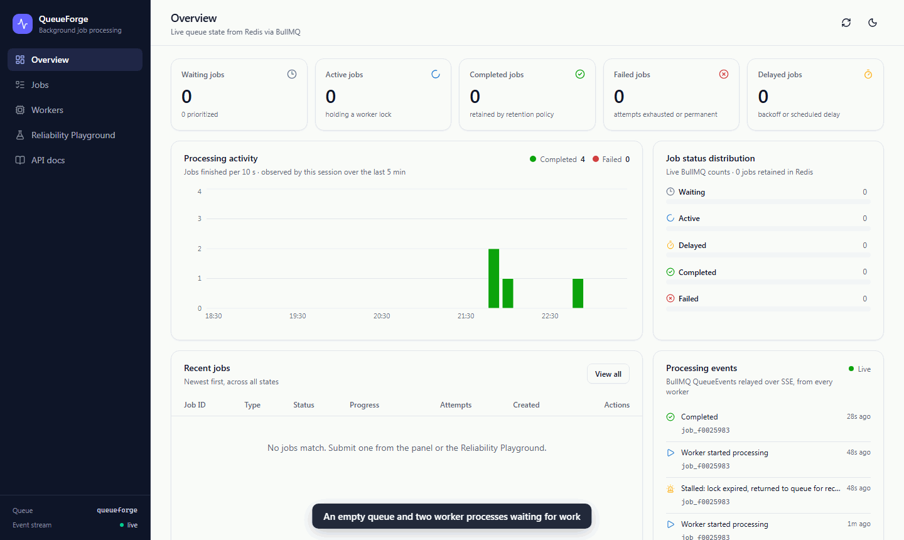

*Recorded from the real system: 60 jobs are submitted, two independent worker processes pick them up from Redis, and the dashboard updates live.*

---

## What is this, in plain words?

Think of a busy restaurant kitchen:

| In the kitchen | In QueueForge |
|---|---|
| You place an order and immediately get a **ticket number**. You don't stand in the kitchen waiting. | An app submits a job. The **API** answers in milliseconds with a job ID (`202 Accepted`). |
| Tickets go on the **order rail**. | Jobs are stored in a **queue in Redis** (a fast database). |
| Several **cooks** take tickets and cook in parallel. Hire more cooks to go faster. | Independent **worker processes** take jobs and run them. Add more workers to go faster. |
| A dish burns, so the cook tries again, waiting a bit longer each time. | A job hits a temporary error, so it is **retried automatically** after 1 s, then 2 s. |
| You order the same thing twice by accident; the kitchen notices and cooks it once. | Duplicate submissions are **detected and suppressed**. |
| **A cook collapses mid-dish.** Shortly after, another cook notices the abandoned ticket and finishes it. Nobody has to re-order. | **A worker process is killed mid-job.** Another worker detects it and finishes the *same* job. Nothing is lost or resubmitted. |
| A screen on the wall shows every order live. | The **dashboard** shows queues, workers, progress and events in real time. |

**Why does this matter?** Real products do this all the time: sending emails, generating PDFs and reports, resizing images, processing payments or uploads. Users shouldn't have to wait for that work, and it must not be lost when a server crashes or restarts. This project builds that infrastructure from the ground up and *proves* it survives a crash.

## What it shows

### 1. A job survives its worker crashing (the main feature)

A 20-second job is running. Its worker process is **killed** (`SIGKILL`, like pulling the plug). The job does not disappear: once the dead worker's lock expires, a healthy worker detects it and finishes the same job.

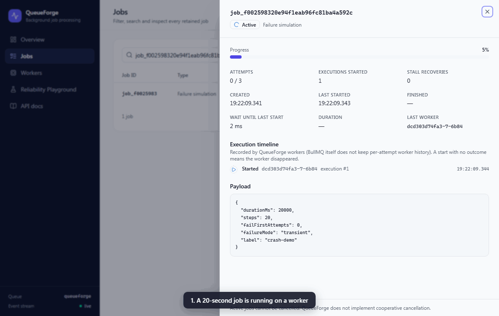

*Recorded from the real system (captions added). The timeline on the right is written by the workers themselves: Started, Recovered after stall, Started, Completed.*

None of this is simulated. An automated test kills a real operating-system process and checks the outcome in a real Redis database, and you can run it yourself with `npm run demo:crash-recovery` ([how it works](#crash-recovery-flagship)).

### 2. Automatic retries with growing waits

A job that fails twice is retried automatically, waiting 1 s and then 2 s (*exponential backoff*), and succeeds on its third attempt. Every attempt and its error are visible.

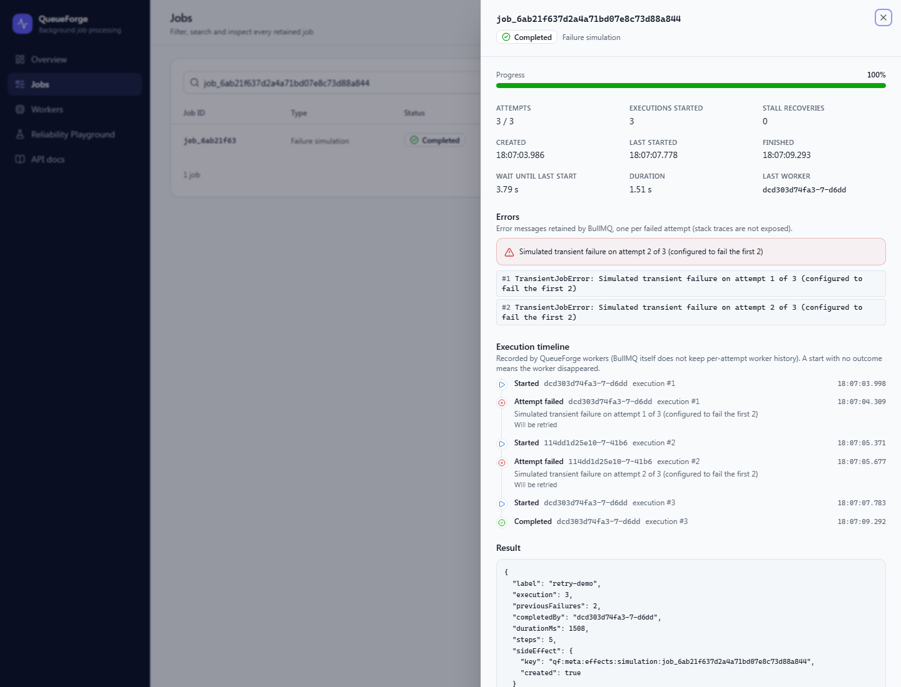

### 3. A Reliability Playground to try it yourself

One-click demonstrations: submit 100 jobs, a job that fails twice, a duplicate submission (the second one is suppressed), a long-running job, and a worker crash.

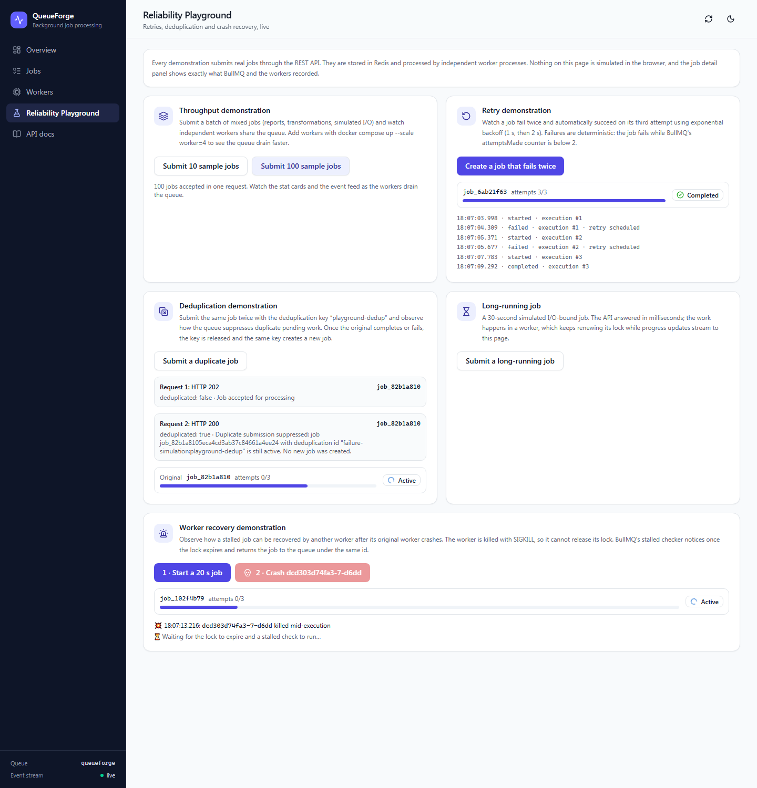

### 4. Everything is measured and tested, not just claimed

- **108 automated tests**, run against a real Redis database and real worker processes, including killing a worker mid-job.
- **Benchmarks** measured on real hardware: 1 worker → 39 jobs/s, 4 workers → 152 jobs/s for I/O-bound work ([details](#performance)).
- **One command** starts the whole system in Docker.

## Skills demonstrated

| Concept | Where to look |
|---|---|
| Asynchronous processing and message queues | Fastify API → BullMQ queue in Redis → independent workers |
| Distributed workers and horizontal scaling | `docker compose up --scale worker=4`; [benchmarks](#performance) |
| Fault tolerance and crash recovery | Lock expiry and stalled-job detection; [a real `SIGKILL` test](#crash-recovery-flagship) |
| Retries and exponential backoff | Transient vs. permanent errors; [retry strategy](#retry-strategy) |
| Deduplication and idempotency | Duplicate suppression plus side effects that are safe to repeat; [details](#deduplication-and-idempotency) |
| Real-time systems | Server-Sent Events from Redis to the browser |
| Testing distributed behaviour | Unit, API, integration and reliability tests; [testing](#testing) |
| Containers and CI | Multi-stage Dockerfile, Docker Compose, GitHub Actions |
| Honest engineering | At-least-once (not "exactly-once") semantics, documented limitations and tradeoffs |

## Try it in 2 minutes

You only need [Docker Desktop](https://www.docker.com/products/docker-desktop/).

```bash
git clone https://github.com/mariusgreiersen/queueforge-worker-system.git
cd queueforge-worker-system
docker compose up --build
```

Then open **http://localhost:8080**, go to **Reliability Playground** and:

1. Click **Submit 100 sample jobs**, then switch to **Overview** to watch them being processed.
2. Click **Create a job that fails twice** and watch it retry and succeed.
3. Click **Start a 20 s job**, then **Crash** its worker, and watch another worker take over (about 15–20 s).

Click any job to see its full details. Stop everything with `docker compose down`.

## How it fits together

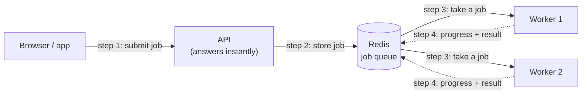

The API and the workers never talk to each other directly. Everything goes through Redis, which is why any worker can die without taking the system, or its jobs, down with it.

---

# Technical documentation

Everything below is the engineering detail: architecture, guarantees, tests, benchmarks and tradeoffs.

## Contents

- [Why background processing?](#why-background-processing)
- [Features](#features)
- [Architecture](#architecture)
- [Technology choices](#technology-choices)
- [Job lifecycle](#job-lifecycle)
- [Job types](#job-types)
- [Retry strategy](#retry-strategy)
- [Deduplication and idempotency](#deduplication-and-idempotency)
- [Crash recovery (flagship)](#crash-recovery-flagship)
- [Quick start](#quick-start)
- [REST API](#rest-api)
- [Dashboard](#dashboard)
- [Testing](#testing)
- [Performance](#performance)
- [Reliability and operations](#reliability-and-operations)
- [Security](#security)
- [Technical tradeoffs](#technical-tradeoffs)
- [Project structure](#project-structure)
- [Configuration](#configuration)
- [Future improvements](#future-improvements)

## Why background processing?

When an HTTP handler generates a report, transforms a dataset or calls a slow third-party service before it responds, it causes four problems:

- the client waits, and may time out;
- the server holds a connection and memory for the whole duration;
- a crash or deploy in the middle of the work silently loses it;
- traffic spikes go straight to the slowest part of the system.

QueueForge separates **accepting** work from **doing** it. The API validates a request, writes a job to a Redis-backed BullMQ queue and answers **`202 Accepted`** with a job ID within milliseconds. Independent worker processes pull jobs from Redis, report progress, retry transient failures with exponential backoff, and recover jobs whose worker died. Clients follow progress through the REST API or the live dashboard.

## Features

| Area | What is implemented |
|---|---|
| **API** | Fastify REST API under `/api/v1`, Zod validation, consistent JSON errors, OpenAPI 3 docs at `/docs`, liveness and readiness probes |
| **Queue** | One BullMQ queue in Redis; the job type is carried by the job name; priorities, delays, and bounded retention of completed and failed jobs |
| **Workers** | Standalone processes with configurable concurrency, progress reporting, structured results, graceful `SIGTERM` shutdown and heartbeats; scale horizontally with `--scale worker=N` |
| **Retries** | BullMQ-native exponential backoff (default 3 attempts, 1 s → 2 s); transient vs. permanent error classification; manual retry of failed jobs |
| **Deduplication** | BullMQ Simple Mode keyed by `<job type>:<key>`; duplicates are reported explicitly (`deduplicated: true`, existing job ID, HTTP 200) |
| **Idempotency** | Side effects written with `SET NX` under IDs derived from the job ID, so re-execution never duplicates them |
| **Crash recovery** | BullMQ lock and stalled-job detection with tuned lock duration and stalled interval; `maxStalledCount` prevents endless recovery loops |
| **Cancellation** | Safe cancellation of jobs that have not started (atomic, lock-aware); active jobs are refused honestly |
| **Live dashboard** | React, Tailwind and shadcn/ui; stat cards, charts, job table with filters and search, job detail panel with a worker-recorded execution timeline, worker heartbeats, SSE event feed, light and dark themes |
| **Reliability Playground** | One-click demonstrations of throughput, retries, deduplication, long-running jobs and worker crash recovery |
| **Testing** | 60 unit tests and 48 API, integration and reliability tests against real Redis (Testcontainers or a CI service), including real `SIGKILL` crash recovery |
| **Ops** | Multi-stage Dockerfile, Docker Compose (Redis with AOF persistence, API, scalable workers, nginx-served dashboard), GitHub Actions CI, benchmark script |

## Architecture

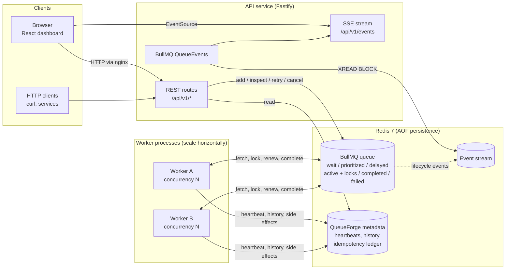

The API and the workers never call each other. **All coordination goes through Redis.** A worker can disappear at any moment, and the queue and the remaining workers carry on.

| Component | Responsibilities |
|---|---|
| **API** (`apps/api`) | Validate and enqueue jobs, look up and list jobs, queue statistics, manual retry and cancel, worker list from heartbeats, SSE fan-out of BullMQ `QueueEvents`, health probes, OpenAPI |
| **Worker** (`apps/worker`) | Run processors, report progress, classify errors, record execution history, publish heartbeats, shut down gracefully; BullMQ handles locking, retries and stalled recovery |
| **Redis** | Queue state, job data and results, processing locks, delayed and retry scheduling, deduplication keys, the event stream, QueueForge metadata |
| **Dashboard** (`apps/dashboard`) | Static SPA served by nginx, which also proxies `/api` so the browser talks to one origin |
| **Shared** (`packages/shared`) | Zod schemas, DTO types and constants used by the API, workers and dashboard; Node helpers (Redis profiles, key layout, logger) |

**Redis key layout** (`QUEUE_PREFIX=qf`):

| Keys | Owner | Purpose |
|---|---|---|
| `qf:queueforge:*` | BullMQ | Jobs, state lists and sets, locks, events stream, deduplication keys |
| `qf:meta:workers:<id>` | Workers | Heartbeat JSON, `EX 15` |
| `qf:meta:history:<jobId>` | Workers | Per-job execution history (bounded list, 7-day TTL) |
| `qf:meta:effects:<scope>:<id>`, `qf:meta:effects-log:<jobId>` | Workers | Idempotency markers (`SET NX`) and the audit log of performed side effects |
| `qf:meta:reports:<reportId>` | Workers | Stored report artifacts |
| `qf:meta:cancelled:<jobId>` | API | Tombstone so cancelled jobs remain queryable for 7 days |

## Technology choices

| Choice | Why |
|---|---|
| **Node.js 24 + TypeScript (strict)** | Job processing here is mostly I/O orchestration, which suits Node's event loop. Strict types plus shared Zod schemas keep the API, workers and dashboard in agreement on every payload. |
| **BullMQ** | A mature, Lua-scripted queue on Redis with atomic state transitions, job locks, stalled-job detection, exponential backoff, deduplication, priorities and an event stream. QueueForge uses these primitives rather than reimplementing them. |
| **Redis** | In-memory speed for queue operations, with optional persistence (AOF), sorted sets for delays, and streams for events. One dependency that is simple to run locally. |
| **Fastify + Zod** | Fast, schema-driven HTTP. One Zod schema per endpoint validates the request, serializes the response (dropping unknown fields) and generates the OpenAPI document. |
| **Pino** | Low-overhead structured JSON logs with job, worker, queue and attempt context. |
| **React, Vite, Tailwind, shadcn/ui, Recharts** | A fast, accessible, themeable dashboard built from owned component code. |
| **Vitest + Testcontainers** | Fast unit tests, plus integration tests against a real Redis that start automatically when Docker is available. |

## Job lifecycle

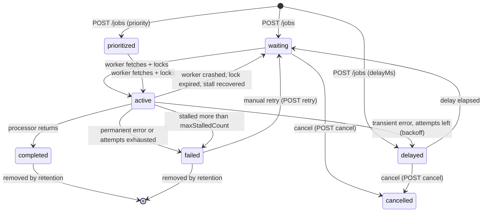

`stalled` is an **event**, not a state. A stalled job moves from `active` back to `waiting` (or to `failed`), and the dashboard shows `Recovered after stall` in the job's execution timeline. `cancelled` is a QueueForge tombstone: BullMQ removes the job, and the API keeps a snapshot so `GET /jobs/:id` still answers.

## Job types

All three processors do real work. None of them is a bare `setTimeout`, except the simulator, whose purpose is to model I/O wait.

| Type | Input | Processing | Output |
|---|---|---|---|
| `report-generation` | `reportName`, `recordCount` (≤ 200 000), `format` (`json`/`csv`), optional `batchDelayMs` (simulated per-batch I/O) | Generates deterministic sales records from a PRNG seeded by the report name. Aggregates them in batches of 500, updates progress after each batch and **yields to the event loop** between batches so lock renewal never starves. Stores the report once. | Report ID (derived from the job ID), records processed, revenue/quantity/min/max/average, per-region and per-category breakdowns, top products, optional CSV, duration |
| `data-transformation` | `records` (≤ 5 000 flat objects, ≤ 50 fields), `operations` (≤ 10) | Pipeline of `filter` (eq, neq, gt, gte, lt, lte, contains, in), `normalize` (trim, lowercase, uppercase, min-max, round), `dedupe`, `sort`, `group` with aggregates, and `aggregate` (count, sum, avg, min, max) | Transformed records, aggregates, per-step metadata (input and output counts, duration) |
| `failure-simulation` | `durationMs` (≤ 120 s), `steps`, `failFirstAttempts`, `failureMode` (`transient`/`permanent`), `label` | Deterministically fails while BullMQ's `attemptsMade < failFirstAttempts`, otherwise runs for `durationMs` reporting progress. Records one side effect at the end. | Execution number, previous failures, completing worker, side-effect record |

There is no way to submit code, shell commands or scripts. Every payload is validated by a strict Zod schema (unknown fields are rejected) in the API, and **validated again in the worker** before it reaches a processor. Invalid stored data fails permanently instead of being retried.

## Retry strategy

Retries use BullMQ's built-in mechanism. QueueForge configures it per job and contains no custom retry loop.

| Setting | Default | Client-tunable range |
|---|---|---|
| Total attempts (including the first) | 3 | 1–5 (`options.attempts`) |
| Backoff | exponential, 1 000 ms initial | 100–10 000 ms initial (`options.backoffDelayMs`) |

BullMQ waits `initialDelay × 2^(attempt−1)` between attempts:

```
attempt 1  ✗ TransientJobError ──► wait 1 s
attempt 2  ✗ TransientJobError ──► wait 2 s
attempt 3  ✓ completed                 (attemptsMade = 3 / 3)
```

That sequence was observed in the dashboard (failures at `.309` and `.677`, next attempts started 1.06 s and 2.11 s later):


- **Transient vs. permanent errors.** A processor throws `PermanentJobError` (a subclass of BullMQ's `UnrecoverableError`) for errors that retrying cannot fix: invalid input, or non-numeric data for `min-max`. BullMQ then fails the job immediately instead of spending its remaining attempts. Unknown errors count as transient, so they get a bounded number of retries.
- **After the last attempt** the job stays in `failed` (with `retries-exhausted` emitted) until it is retried manually (`POST /jobs/:id/retry`, which resets the attempt budget) or removed by retention.
- **Backoff is a minimum delay, not a start time.** After its delay a retried job rejoins the back of the queue. During a burst of 100 jobs, a third attempt scheduled 2 s out actually started about 39 s later, because it waited behind the backlog. That is expected FIFO behaviour.
- The dashboard shows attempts made and maximum, every attempt's error, and a **"Retry scheduled"** state (`awaitingRetry: true`) while a job sits in `delayed` because of backoff.

## Deduplication and idempotency

These are two different guarantees, and QueueForge implements both.

### 1. Suppressing duplicate submissions (deduplication)

When `options.deduplicationKey` is set, the API passes `deduplication: { id: "<job type>:<key>" }` to BullMQ (**Simple Mode**: no TTL). Scoping by job type means the same key used for different job types never collides.

- While a job holding that ID is **waiting, delayed or active**, an identical submission creates nothing. BullMQ's Lua script returns the existing job's ID atomically. The API detects this by comparing it with the ID it requested, and answers **HTTP 200** with `deduplicated: true` and the existing `jobId`. It never claims a new job was created.
- When the original job **completes or fails**, BullMQ releases the key, so the next submission creates a new job. Cancelling a pending job also releases the key (covered by a test).

### 2. Tolerating repeated execution (idempotency)

Deduplication does **not** give exactly-once execution. BullMQ, like every practical queue, delivers jobs **at least once**. If a worker dies after doing some work but before marking the job complete, the job is executed again. **QueueForge therefore does not claim exactly-once execution.** Processors are designed so that running twice is harmless:

- **Stable identifiers.** Job IDs are generated once by the API, and the report ID is `sha256(jobId)`, so a re-run writes to the same key.
- **Deterministic inputs.** The same input always produces the same output.
- **Idempotent side effects.** Each persistent effect is written with `SET <marker> NX` under an ID derived from the job ID. A second execution finds the marker and skips the write. An audit list records only effects that were actually performed, which lets the tests assert *exactly one* side effect even though the job ran twice.

The idempotency ledger protects effects inside this Redis. An effect in **another system** (sending an email, charging a card, calling a webhook) needs that system to accept an idempotency key, or a transactional outbox. Otherwise a crash between "effect done" and "job completed" can still repeat it.

## Crash recovery (flagship)

### How it works

1. **Locks.** When a worker takes a job, BullMQ sets `…:<jobId>:lock` with a `PX lockDuration` expiry. The worker renews it every `lockDuration / 2`, and each renewal also removes the job from the queue's *stalled* set.
2. **Stalled checks.** Every worker runs a stalled checker, throttled by a global Redis key to at most one check per `stalledInterval` across the cluster. Each check (a) moves jobs that were in the stalled set and **have no lock** back to `wait`, emitting a `stalled` event, and (b) adds all current `active` jobs to the stalled set for the next round.
3. **A crash stops renewals.** After `SIGKILL` the lock expires within `lockDuration`, and the first stalled check after that returns the job to `wait`. Expected detection time is roughly `lockDuration/2 … lockDuration + stalledInterval`.
4. **Recovery.** Any worker, including the restarted one, picks the job up **with the same job ID**. `attemptsStarted` and `stalledCounter` increase; `attemptsMade` does not, because a crash is not a failed attempt. The recovering worker records `stalled-recovered` in the job's execution history.
5. **No infinite loops.** After more than `maxStalledCount` stalls, BullMQ fails the job with *"job stalled more than allowable limit"*. In BullMQ 6 this is a deferred failure: the job is marked and returned to `wait`, and the next worker fails it **without running the processor** (verified by a test).

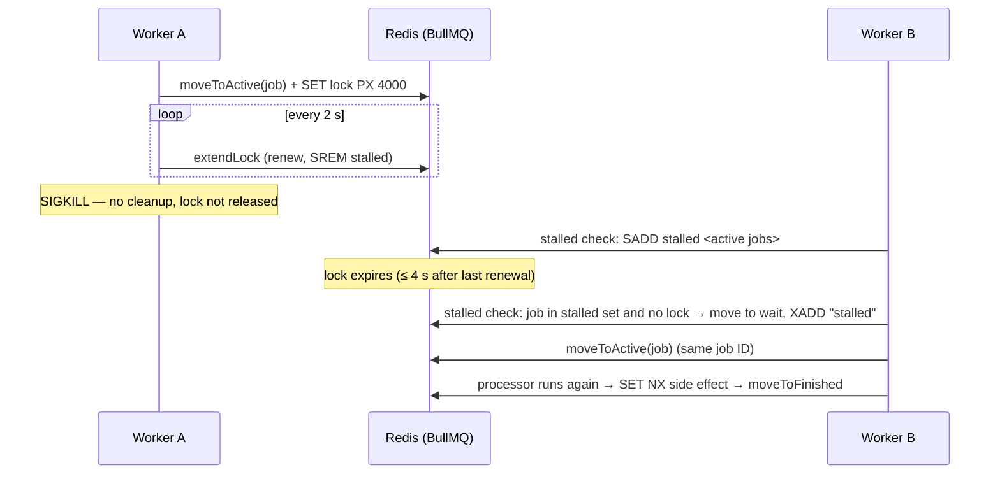

### Configuration

| Setting | Compose default | Tests / demo | Notes |
|---|---|---|---|
| `WORKER_LOCK_DURATION_MS` | 15 000 | 4 000 / 5 000 | Upper bound on detecting a dead worker. Too low risks false stalls under heavy CPU load. |
| `WORKER_STALLED_INTERVAL_MS` | 5 000 | 2 000 / 2 500 | Cluster-wide check cadence. |
| `WORKER_MAX_STALLED_COUNT` | 2 | 1 (0 in the limit test) | Recoveries allowed before a job is failed. |
| `WORKER_CONCURRENCY` | 3 | 2 | Jobs per worker process. |
| `WORKER_SHUTDOWN_TIMEOUT_MS` | 25 000 | 20 000 | Graceful drain limit before exit (jobs still running are then recovered as stalls). |

Short locks make demos fast. The production-appropriate value depends on how long processors can block the event loop. BullMQ's default is 30 s.

### The automated test

`tests/reliability/crash-recovery.test.ts` runs against **real Redis** with **two real worker processes** (`node --import tsx apps/worker/src/main.ts`, spawned directly so the signal reaches the worker and not a wrapper):

1. starts Worker A and Worker B;
2. submits an 8-second job through the same `JobService` the API uses;
3. waits until a worker is actually executing it (first progress event);
4. **kills that worker's process with `SIGKILL`** and verifies it did not exit cleanly and that the job is still `active` in Redis;
5. waits (event-driven, bounded) for BullMQ's `stalled` event, then for `completed`;
6. asserts: same job ID; completed by the surviving worker; `stalledCounter = 1`; `attemptsStarted = 2`; `attemptsMade = 1`; a valid result (full duration, all 16 steps); **exactly one side effect** in the ledger; and a history of `started@victim → stalled-recovered@survivor → started@survivor → completed@survivor`;
7. records the observed timings to `tests/.results/crash-recovery.json`, which CI uploads as an artifact.

**Observed timings** (lock 4 s, stalled interval 2 s, 8 s job):

| Run | Kill → stall detected | Kill → job completed |
|---|---:|---:|
| Linux container (`npm run test:docker`, Node 24.22), run 1 | 5.45 s | 13.47 s |
| Linux container (`npm run test:docker`, Node 24.22), run 2 | 7.48 s | 15.51 s |
| Windows 10 host (Node 24.14), run 1 | 3.49 s | 11.71 s |
| Windows 10 host (Node 24.14), run 2 | 3.51 s | 11.75 s |

Detection varies with where in the renewal and check cycles the kill lands; the test asserts it stays within `lockDuration + 2 × stalledInterval + 2 s`. Completion time includes re-running the whole 8-second job from the start: recovery restarts work, it does not resume it. The companion test `stalled-limit.test.ts` shows that `maxStalledCount` turns repeated crashes into a failure instead of a loop.

### Reproduce it: `npm run demo:crash-recovery`

With Redis running (`docker compose up -d redis`), this starts the API and two workers under an isolated key prefix, submits a 10-second job over HTTP, kills the worker processing it, and narrates what happens. Output from an actual run (Windows host, lock 5 s, stalled interval 2.5 s):

```
+  2.57s  📨  Submitted job job_37c553a53b244741ac9fb1b558fd6330 → HTTP 202, status=active
+  3.09s  ▶️   worker-a is processing the job (progress 5%)
+  3.11s  💥  Killed worker-a (pid 18560) with SIGKILL (exit code=null, signal=SIGKILL)
+  3.12s  ⏳  Job is still "active" in Redis. Waiting for its lock to expire and for a stalled check to notice it
+ 10.03s  🔎  Stalled job detected by BullMQ 6.93s after the kill → job returned to the queue
+ 20.34s  ✅  Job completed 17.25s after the kill

Checks
  ✔ Same job id retained (no resubmission)
  ✔ Final state is completed
  ✔ Completed by the surviving worker (worker-b)
  ✔ Executed twice: crashed attempt + recovery (attemptsStarted = 2)
  ✔ Stall recorded by BullMQ (stalledCounter = 1)
  ✔ No retry attempt consumed by the crash (attemptsMade = 1)
  ✔ Result is valid (full duration, all steps)
  ✔ Exactly one persistent side effect
  ✔ History shows the stall recovery

PASS: worker crash recovery verified
```

You can also trigger it in the browser: Reliability Playground → *Start a 20 s job* → *Crash worker* (local Docker Compose only). Below, the worker in container `dcd303…` was killed, and the worker in container `114dd1…` recovered the job about 17 s later (lock 15 s):

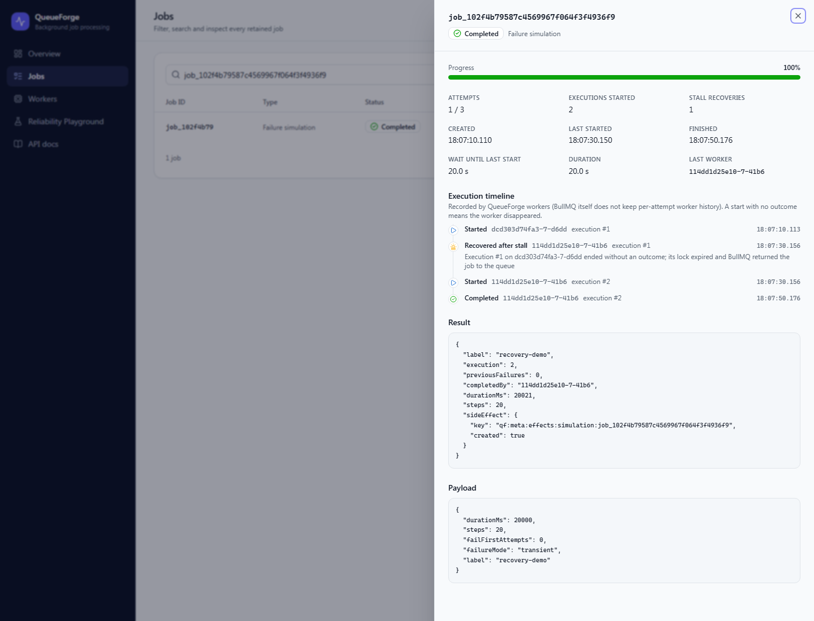

### Limitations

- **Detection is not instant.** It is bounded by lock expiry plus a stalled check. Shorter locks detect faster but risk false stalls when a processor blocks the event loop. Processors therefore yield between chunks of CPU work.
- **Work restarts from zero.** There is no checkpointing; long jobs should be split, or should store resumable checkpoints.
- **At-least-once.** A crash after an external side effect repeats it unless that effect is idempotent (see above).
- **This is worker failure, not Redis failure.** Recovery assumes Redis survives. See [Redis durability](#technical-tradeoffs).
- **Lesson learned: PID 1 in containers.** The first Docker run of the crash demo did nothing. The worker ran as PID 1, and Linux ignores signals that PID 1 sends to itself, including `SIGKILL`. The Compose services now run under an init process (`init: true`), and the handler falls back to `process.abort()` if it is PID 1. Restarted containers also reuse `hostname` and PID, so worker IDs carry a per-process random suffix; otherwise a crashed worker and its replacement would share an ID in the history.

## Quick start

**Prerequisites:** Docker with Compose v2. For local development without containers: Node.js ≥ 24 and npm.

```bash
git clone https://github.com/mariusgreiersen/queueforge-worker-system.git
cd queueforge-worker-system
docker compose up --build
```

| Service | URL |
|---|---|
| Dashboard | http://localhost:8080 |
| REST API | http://localhost:3000 |
| OpenAPI docs | http://localhost:3000/docs |
| Redis | `127.0.0.1:6379` (local only) |

**Scale the workers** (two replicas by default). Each replica gets a unique worker ID, and BullMQ distributes jobs among them:

```bash
docker compose up -d --scale worker=4
```

**Graceful stop:** `docker compose stop worker` sends `SIGTERM`. Each worker stops fetching, finishes its active jobs within `WORKER_SHUTDOWN_TIMEOUT_MS` (Compose allows 30 s), removes its heartbeat and exits 0.

### Local development (without containers for the app)

```bash
npm ci
docker compose up -d redis          # or any Redis 6.2+ on localhost:6379
npm run dev:api                     # http://localhost:3000
npm run dev:worker                  # start as many as you like, in separate terminals
npm run dev:dashboard               # http://localhost:5173 (proxies /api to :3000)
```

Set `LOG_PRETTY=true` for human-readable logs.

## REST API

Base path `/api/v1`. Full schema at **`/docs`** (Swagger UI) and `/docs/json` (OpenAPI 3).

| Method | Path | Description |
|---|---|---|
| `POST` | `/jobs` | Submit a job: `202` when created, `200` + `deduplicated: true` when suppressed |
| `POST` | `/jobs/batch` | Submit up to 100 jobs in one request |
| `GET` | `/jobs/:id` | Job details: state, progress, attempts, timestamps, result, errors, execution history |
| `GET` | `/jobs` | List with `state`, `type`, `search`, `sort=newest\|oldest`, `page`, `pageSize` |
| `POST` | `/jobs/:id/retry` | Retry a job in the terminal `failed` state (`409` otherwise) |
| `POST` | `/jobs/:id/cancel` | Cancel a waiting, prioritized or delayed job (`409` for active or finished jobs) |
| `GET` | `/queues/stats` | Live BullMQ counts: waiting, prioritized, active, delayed, completed, failed |
| `GET` | `/workers` | Workers with recent heartbeats |
| `GET` | `/events` | Server-Sent Events stream of queue lifecycle events |
| `GET` | `/config` | Public config: retry policy, retention, whether demo controls are on |
| `POST` | `/demo/workers/:id/crash` | **Local dev only**: exists only when `DEMO_CONTROLS_ENABLED=true` |
| `GET` | `/health/live`, `/health/ready` | Liveness (process up) and readiness (Redis reachable, not shutting down) |

Errors always look like `{ "error": { "code", "message", "details?" }, "requestId" }`. Codes include `VALIDATION_ERROR` (400), `NOT_FOUND` (404), `JOB_NOT_RETRYABLE`, `JOB_ACTIVE` and `JOB_FINISHED` (409), `PAYLOAD_TOO_LARGE` (413), `UNSUPPORTED_MEDIA_TYPE` (415), `REDIS_UNAVAILABLE` (503) and `INTERNAL_ERROR` (500, no stack traces).

**Examples** (responses captured from the running Compose stack):

```bash
# Submit
curl -i -X POST http://localhost:3000/api/v1/jobs -H 'content-type: application/json' -d '{
  "type": "report-generation",
  "data": { "reportName": "Monthly Sales Report", "recordCount": 100000, "format": "json", "batchDelayMs": 20 },
  "options": { "priority": 2, "deduplicationKey": "monthly-sales-report" }
}'
# HTTP/1.1 202 Accepted
# {"jobId":"job_3df290b9e7cd4d66898e408e5d311d5d","status":"prioritized","deduplicated":false,
#  "deduplicationId":"report-generation:monthly-sales-report","message":"Job accepted for processing"}

# Same request while the first one is still running
# HTTP/1.1 200 OK
# {"jobId":"job_3df290b9e7cd4d66898e408e5d311d5d","status":"active","deduplicated":true, ...
#  "message":"Duplicate submission suppressed: job job_3df2… is still active. No new job was created."}

# Invalid payload
curl -X POST http://localhost:3000/api/v1/jobs -H 'content-type: application/json' \
  -d '{"type":"report-generation","data":{"reportName":"","recordCount":-5}}'
# HTTP/1.1 400 Bad Request
# {"error":{"code":"VALIDATION_ERROR","message":"Request validation failed","details":[
#   {"path":"/data/reportName","message":"Too small: expected string to have >=1 characters","location":"body"},
#   {"path":"/data/recordCount","message":"Too small: expected number to be >=1","location":"body"}]},
#  "requestId":"f1440e53-…"}

# Inspect (abridged)
curl http://localhost:3000/api/v1/jobs/job_3df290b9e7cd4d66898e408e5d311d5d
# {"id":"job_3df2…","type":"report-generation","state":"completed","progress":100,
#  "attemptsMade":1,"attemptsStarted":1,"maxAttempts":3,"durationMs":4188,
#  "processedBy":"dcd303d74fa3-7-39a4",
#  "result":{"reportId":"rpt_8b757abf41731afc","recordsProcessed":100000,"batches":200,
#            "summary":{"totalRevenue":264906400.7,"averageOrderValue":2649.06, …},
#            "stored":{"key":"qf:meta:effects:report:rpt_8b757abf41731afc","created":true}},
#  "history":[{"event":"started",…},{"event":"completed",…}], …}

# Other operations
curl http://localhost:3000/api/v1/queues/stats
curl 'http://localhost:3000/api/v1/jobs?state=failed&type=failure-simulation&page=1&pageSize=20'
curl -X POST http://localhost:3000/api/v1/jobs/<id>/retry    # 409 JOB_NOT_RETRYABLE unless failed
curl -X POST http://localhost:3000/api/v1/jobs/<id>/cancel   # 409 JOB_ACTIVE if it is running
curl -N http://localhost:3000/api/v1/events                  # live SSE stream
```

**Listing semantics.** BullMQ has no secondary index by job name. A single-state listing without filters therefore uses exact BullMQ range pagination (`exact: true`). Listings across all states, or filtered by type or search, are assembled from a bounded window of the most recent jobs per state (`LIST_SCAN_WINDOW`, default 200), and `exact` reports whether that window covered everything.

## Dashboard

Every number on the dashboard comes from Redis through the API. Nothing is hard-coded or simulated in the browser.

- **Overview:** five stat cards (waiting, active, completed, failed, delayed), a status distribution, a processing-activity chart, a recent-jobs table, the live event feed, workers and a submission panel.
- **Jobs:** filter by state and type, search by job ID (pasting a full ID opens the job directly), sort, paginate; retry and cancel actions where allowed.
- **Job detail panel:** payload, status, live progress, attempts and stall count, every attempt's error, result, timestamps, and the **execution timeline** recorded by workers.
- **Workers:** heartbeat-based cards (ID, PID, concurrency, active jobs, processed and failed counts, heartbeat age, fresh or stale, lock settings). The UI states clearly that "fresh" is a health estimate, not proof of liveness; job ownership is decided by BullMQ locks.
- **Live updates:** an `EventSource` on `/api/v1/events`. The API relays BullMQ `QueueEvents`, which tail Redis's event stream, so it sees events from **every** worker process. It marks `delayed` events that follow a failed attempt as `retry-scheduled`. On every (re)connect the dashboard refetches authoritative state. It also polls as a fallback and replays missed events via `Last-Event-ID`, so events are hints and the REST API is the source of truth.
- **Honest data:** the activity chart counts only completions and failures observed by the current browser session (BullMQ keeps no throughput history unless metrics are enabled) and says so. Execution history exists because workers record it explicitly; BullMQ does not keep per-attempt worker information.

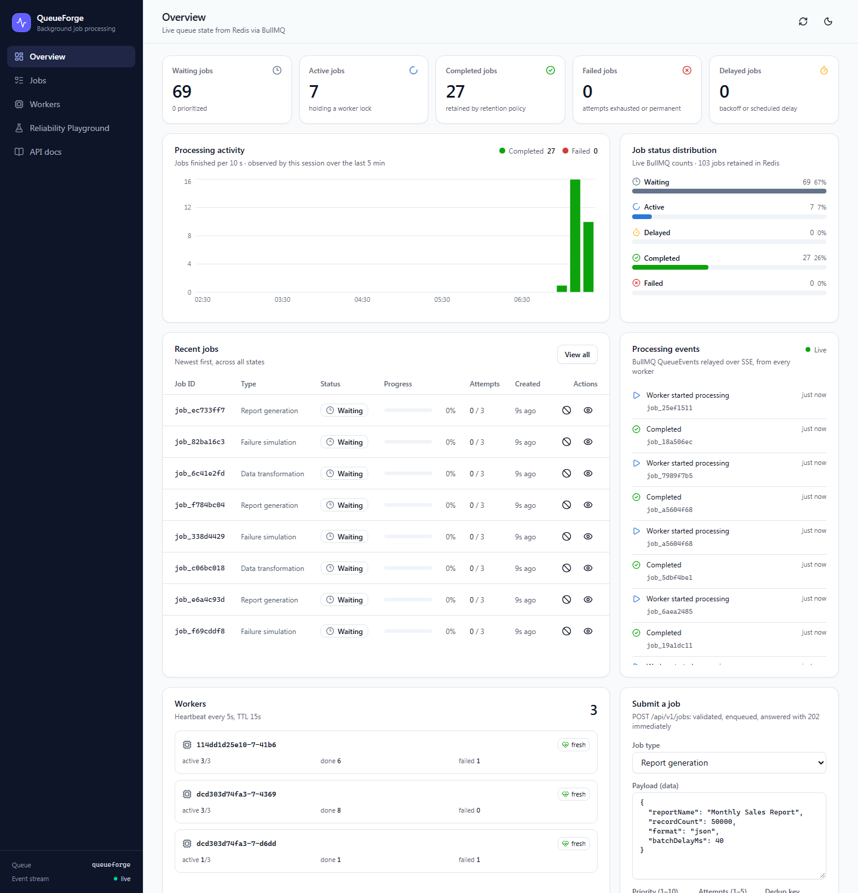

| Reliability Playground | Jobs | Dark mode |
|---|---|---|
|  | 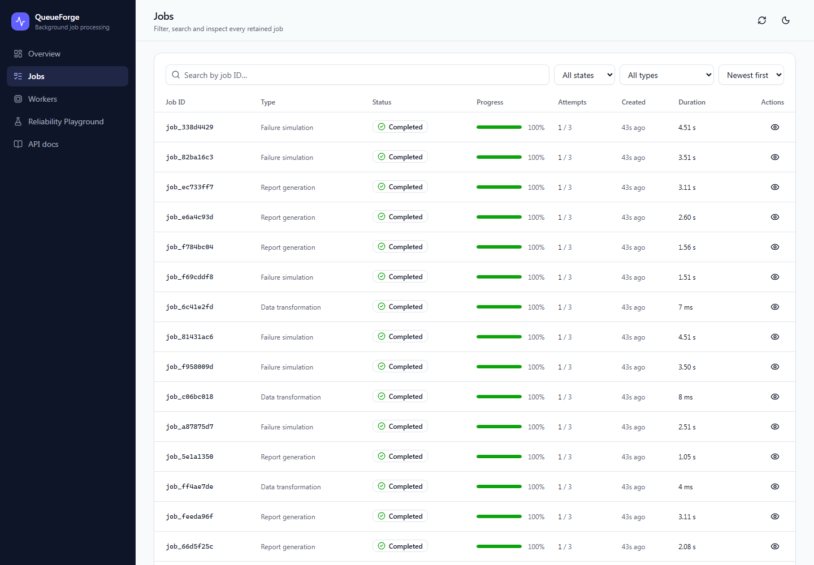 | 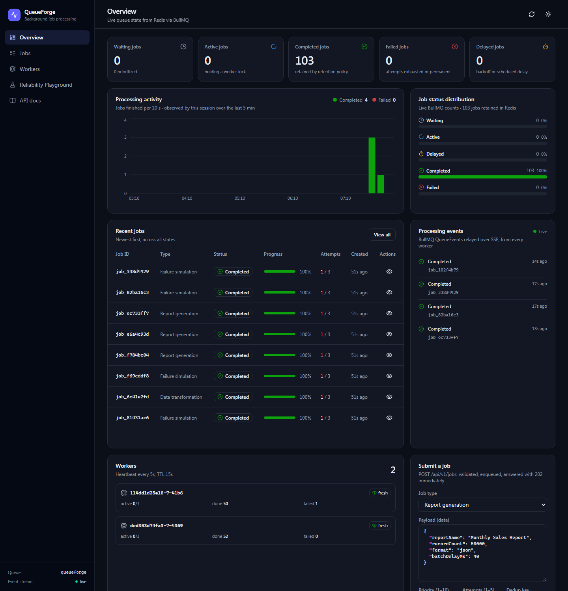 |

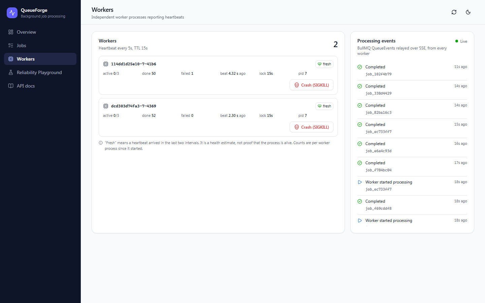

## Testing

```bash
npm run test:unit           # no dependencies
npm run test:integration    # API + integration + reliability; uses REDIS_URL or starts Redis via Testcontainers
npm run test:reliability    # just the crash / stall-limit / graceful-shutdown suites
npm run test:docker         # whole suite inside Linux containers (needs Docker)
```

| Suite | Count | What it covers |
|---|---:|---|
| `tests/unit` | 60 | Zod validation and limits, configuration parsing, Redis connection profiles, error classification, job dispatch (routing, invalid payloads, retry decisions, stall-recovery recording), job → DTO mapping, all three processors (determinism, progress, CSV, every transformation op), **idempotent re-execution** |
| `tests/api` | 30 | Fastify `inject` against real Redis: valid, invalid, oversized and non-JSON submissions; dedup responses; batch limits; get, list, filter, search, pagination; stats against BullMQ counts; retry and cancel rules (including refusing an active job); health; OpenAPI; CORS; demo routes absent by default; **Redis unavailable → fast 503 and not-ready** |
| `tests/integration` | 15 | Real workers on real Redis: results, progress events, **fails twice then succeeds with measured 1 s / 2 s backoff**, `awaitingRetry`, exhausted retries stay failed, permanent errors skip retries, worker-side validation, **dedup while waiting and while active, then a new job after completion**, type scoping, key released on cancel, **re-execution without a duplicate side effect**, two independent worker processes sharing a queue |
| `tests/reliability` | 3 | **SIGKILL crash recovery** across processes, the **stalled-count limit** (no infinite loops), **graceful SIGTERM shutdown** (finishes the active job, takes no new work, exits 0) |

Waits are event-driven (`QueueEvents`, log lines from child processes) with explicit timeouts; the few polls are bounded. Each test file uses its own Redis key prefix and deletes its keys afterwards.

**Results from this machine.**

- Windows 10 host: `npm run test:unit` → 60/60 passed. `npm run test:integration` (Redis 7.4 in Docker) → 47 passed and 1 skipped. The graceful-shutdown test is skipped on Windows because Node's `child.kill('SIGTERM')` terminates processes forcibly there, so there is no graceful path to exercise.
- `npm run test:docker` (Linux, Node 24.22) → 60/60 unit and 48/48 integration, **including graceful shutdown**.

CI (`.github/workflows/ci.yml`) runs `npm ci`, ESLint, TypeScript, unit tests, then integration tests against a Redis service container, then builds all apps. A second job builds every Docker image.

## Performance

`npm run benchmark` starts N independent worker processes, enqueues jobs with `addBulk` (bypassing HTTP), and measures until every job has **finished**. Accepted-but-unfinished jobs are never counted. Each configuration ran once; numbers vary from run to run.

**Environment:** Intel Core i5-7600 @ 3.5 GHz (4 cores / 4 threads), 16 GB RAM, Windows 10 (10.0.19045), Node 24.14.0. Redis 7.4.11 runs in Docker Desktop (WSL 2 VM), workers run on the host, info-level JSON logging is on, and each worker has its own Redis connections.

**I/O-bound** (1 000 `failure-simulation` jobs, each waiting 100 ms; concurrency 5 per worker):

| Workers | Completed | Failed | Total (s) | Throughput (jobs/s) | Queue wait p50 / p95 (ms) | Processing p50 / p95 (ms) |
|---:|---:|---:|---:|---:|---:|---:|
| 1 | 1000 | 0 | 25.43 | 39.3 | 12 667 / 24 001 | 124 / 147 |
| 2 | 1000 | 0 | 12.66 | 79.0 | 6 307 / 11 877 | 125 / 132 |
| 4 | 1000 | 0 | 6.60 | 151.6 | 3 129 / 6 159 | 125 / 157 |

**CPU-bound** (200 `report-generation` jobs, 50 000 records each; concurrency 2 per worker):

| Workers | Completed | Failed | Total (s) | Throughput (jobs/s) | Queue wait p50 / p95 (ms) | Processing p50 / p95 (ms) |
|---:|---:|---:|---:|---:|---:|---:|
| 1 | 200 | 0 | 12.55 | 15.9 | 6 348 / 11 935 | 115 / 185 |
| 2 | 200 | 0 | 10.50 | 19.0 | 5 017 / 9 702 | 187 / 338 |
| 4 | 200 | 0 | 8.70 | 23.0 | 4 245 / 8 299 | 335 / 558 |
| 8 | 200 | 0 | 6.15 | 32.5 | 3 423 / 5 435 | 474 / 666 |

Raw results: [`benchmarks/latest-io.json`](benchmarks/latest-io.json), [`benchmarks/latest-cpu.json`](benchmarks/latest-cpu.json).

**Why scaling is not always linear.**

- **I/O-bound jobs scale almost linearly** (×1.94, then ×3.86): workers mostly wait, so capacity is `workers × concurrency / job time`. The ceiling here is about 50 jobs/s per worker, and the gap to the observed 39 is per-job Redis round trips (fetch, lock, progress, finish, history, ledger) through the Docker Desktop VM, plus logging.
- **CPU-bound jobs scale sub-linearly.** Every worker competes for the same 4 cores with Redis, the Docker VM and the OS. Per-job processing time rises from 115 ms to 474 ms as processes contend for CPU, and concurrency inside one Node process does not add CPU at all. The remaining gain from 4 to 8 workers most likely comes from overlapping each job's Redis round trips with other jobs' computation, not from extra compute.
- **Other limits:** a single Redis instance serializes every queue operation; lock renewals and stalled checks add background load per worker; job-size variance causes stragglers at the end of a batch; and retries consume capacity.

## Reliability and operations

- **Redis connections.** The API uses a fail-fast profile (`enableOfflineQueue: false`, one retry per request, a 3 s operation timeout, background reconnects), so an outage gives a fast `503 REDIS_UNAVAILABLE`, `/health/ready` reports `not-ready`, and requests never hang. Because the outcome of a submission that timed out is unknown, clients should retry with a `deduplicationKey`. Workers and `QueueEvents` use the blocking profile (`maxRetriesPerRequest: null`, capped exponential reconnect), so they ride out a Redis restart. On shutdown, Redis clients are closed with a bounded timeout and then force-disconnected (BullMQ's `close()` would otherwise wait forever for a Redis that is down).
- **Graceful shutdown.** On `SIGTERM`/`SIGINT` the API ends SSE streams, refuses new requests (`503` while closing), drains in-flight requests and closes Redis. Workers mark their heartbeat `shutting-down`, stop fetching, wait for active jobs (up to `WORKER_SHUTDOWN_TIMEOUT_MS`), remove their heartbeat and exit 0. A second signal forces exit. Jobs still running at the timeout are recovered later as stalls.
- **Job retention.** Completed jobs: the latest 1 000, at most 24 h. Failed jobs: the latest 5 000, at most 7 days (BullMQ `removeOnComplete` / `removeOnFail`; trimming happens as later jobs finish). Removed jobs are no longer available through `GET /jobs/:id` or listings. QueueForge metadata expires after 7 days.
- **Redis persistence (Compose).** AOF with `appendfsync everysec` plus RDB snapshots on the `redis-data` volume, and `maxmemory-policy noeviction` (required by BullMQ, since evicting keys would corrupt queue state). Jobs survive `docker compose down` and restarts; `docker compose down -v` deletes them.
- **Logging.** Pino JSON with `service`, `workerId`, `queue`, `jobId`, `jobType`, `attempt`, an `event` name and an ISO timestamp. Events include `job.accepted`, `job.deduplicated`, `job.started`, `job.completed`, `job.retry_scheduled`, `job.failed`, `job.stalled`, `job.stall_recovered`, `worker.started`, `worker.shutting_down`, `worker.stopped` and `redis.error`. Payloads are not logged, and credentials are redacted.

```json
{"level":"warn","time":"2026-10-17T16:07:04.313Z","service":"queueforge-worker","workerId":"dcd303d74fa3-7-d6dd","queue":"queueforge","event":"job.retry_scheduled","jobId":"job_6ab21f637d2a4a71bd07e8c73d88a844","jobType":"failure-simulation","attempt":1,"maxAttempts":3,"errorClass":"transient","error":"Simulated transient failure on attempt 1 of 3 (configured to fail the first 2)","msg":"Attempt failed; retry scheduled with backoff"}
```

## Security

- Strict Zod schemas on every input (unknown fields rejected), bounded sizes (1 MB body, record, field, operation and batch limits) and bounded numeric ranges. Workers validate payloads read from Redis a second time.
- No code, script or command execution of any kind. Processors are a fixed registry keyed by job type.
- Public errors never include stack traces (only the first line of each job error, which is the message); `500` responses are generic unless `EXPOSE_ERROR_DETAILS=true`.
- CORS is allow-listed (`CORS_ORIGINS`); the dashboard is same-origin behind nginx.
- Compose publishes ports on `127.0.0.1` only. Redis has no password in the local setup and must not be reachable from untrusted networks; use `requirepass`/ACLs and TLS (`rediss://` is supported) anywhere else.
- **Demo crash controls are off by default.** The endpoint is registered only with `DEMO_CONTROLS_ENABLED=true`, and only affects workers that opted in with `WORKER_ALLOW_CRASH_COMMANDS=true`. It can only send a fixed `crash` command. The local Compose file enables both; never deploy it as-is.
- **Not production-ready as a public service.** The MVP has no authentication. A publicly exposed job-submission and worker-control API needs authentication (e.g. JWT/OIDC), per-tenant authorization, rate limiting and quotas, which are listed under future improvements.

## Technical tradeoffs

- **Redis durability.** Redis is the system of record for queue state. AOF with `everysec` can lose about 1 s of writes on a host crash, and a single Redis instance is a single point of failure. Worker-crash recovery is not Redis-crash recovery; real HA needs replication with failover (Sentinel or managed Redis). Using Redis does not make the system highly available.
- **At-least-once versus exactly-once.** Exactly-once delivery is not achievable across a crash boundary without distributed transactions. QueueForge chooses at-least-once delivery plus idempotent effects, which is the standard, honest combination.
- **Lock duration.** Short locks give fast crash detection but risk false stalls if the event loop is blocked (hence chunked processing and the yield calls). Long locks are safe but slow to detect a dead worker.
- **Worker concurrency.** Concurrency helps I/O-bound jobs. CPU-bound jobs need more processes (or sandboxed processors and worker threads), not more concurrency; too much concurrency inflates latency and memory.
- **Retry storms.** Exponential backoff spreads retries out, and server-side limits cap attempts (≤ 5) and delays (≤ 10 s initial). If a dependency is down, jitter, circuit breakers or a dead-letter queue would be the next steps.
- **Memory and retention.** Every retained job costs Redis memory (payload plus result). Count and age limits keep it bounded, at the cost of losing old job history; a long-term audit trail belongs in a database.
- **Horizontal scaling.** Workers are stateless and scale freely. The API scales too (each instance tails the event stream independently). Redis is the shared bottleneck; beyond one instance you need queue sharding or Redis Cluster with hash-tagged keys.
- **One queue, many job types.** Simple to operate, but one slow job type can delay others. Per-type queues (or priorities) would isolate them.
- **Listing without an index.** Filtered listings scan a bounded window instead of maintaining a secondary index in Redis, which keeps writes cheap at the cost of exact totals for deep, filtered pagination.

## Project structure

```
queueforge-worker-system/
├── apps/
│   ├── api/src/
│   │   ├── app.ts                  # Fastify app factory (validation, OpenAPI, CORS, hooks)
│   │   ├── server.ts               # entrypoint + graceful shutdown
│   │   ├── config/                 # env → typed config (Zod)
│   │   ├── middleware/errors.ts    # JSON errors, Redis timeout → 503
│   │   ├── queue/                  # Queue / QueueEvents / Redis clients
│   │   ├── routes/                 # /api/v1/jobs, stats, workers, events (SSE), demo, health
│   │   └── services/               # JobService, EventHub (SSE fan-out), job → DTO mapping
│   ├── worker/src/
│   │   ├── main.ts                 # entrypoint + signal handling
│   │   ├── worker.ts               # BullMQ Worker, lifecycle logging, crash control (opt-in)
│   │   ├── handlers/dispatch.ts    # validation, history, error classification, routing
│   │   ├── processors/             # report-generation, data-transformation, failure-simulation
│   │   ├── heartbeat.ts  errors.ts  config/
│   └── dashboard/src/              # React + Vite + Tailwind + shadcn/ui + Recharts
│       ├── components/  pages/  hooks/  context/  services/  lib/
├── packages/shared/src/            # Zod schemas, DTO types, constants; node/ = Redis, keys, logger
├── tests/
│   ├── unit/  api/  integration/  reliability/
│   ├── helpers/                    # per-file isolated test context, fake Redis for unit tests
│   └── setup/redis.ts              # REDIS_URL or Testcontainers
├── scripts/
│   ├── demo-crash-recovery.ts      # npm run demo:crash-recovery
│   ├── benchmark.ts                # npm run benchmark
│   └── lib/harness.ts              # spawns and kills real API/worker processes
├── docker/                         # nginx.conf, redis.conf, docker-compose.test.yml
├── benchmarks/                     # measured results (JSON)
├── docs/screenshots/
├── .github/workflows/ci.yml
├── Dockerfile                      # multi-stage: api | worker | dashboard | test
├── docker-compose.yml
└── .env.example
```

## Configuration

All settings are environment variables, validated at startup (invalid values stop the process with a readable error). See [`.env.example`](.env.example) for the full list with defaults. The most important ones:

| Variable | Default | Used by |
|---|---|---|
| `REDIS_URL` | `redis://127.0.0.1:6379` | API, worker |
| `QUEUE_PREFIX` | `qf` | API, worker |
| `API_PORT` / `CORS_ORIGINS` | `3000` / `http://localhost:5173,http://localhost:8080` | API |
| `REDIS_OPERATION_TIMEOUT_MS` | `3000` | API |
| `KEEP_COMPLETED_COUNT` / `KEEP_FAILED_COUNT` | `1000` / `5000` | API (per-job retention) |
| `WORKER_CONCURRENCY` | `3` | worker |
| `WORKER_LOCK_DURATION_MS` / `WORKER_STALLED_INTERVAL_MS` / `WORKER_MAX_STALLED_COUNT` | `15000` / `5000` / `2` | worker |
| `DEMO_CONTROLS_ENABLED` / `WORKER_ALLOW_CRASH_COMMANDS` | `false` / `false` | API / worker (local dev only) |
| `LOG_LEVEL` / `LOG_PRETTY` | `info` / `false` | all |

## Future improvements

Not implemented. These are the natural next steps:

- Dead-letter queue for jobs that exhaust their retries, with replay tooling
- Per-tenant job isolation (queue per tenant, fair scheduling, quotas)
- JWT or OIDC authentication and role-based authorization for the API and dashboard
- Distributed rate limiting (BullMQ group limiter and API rate limits)
- Prometheus metrics (queue depth, latency histograms, retry and stall rates) and Grafana dashboards
- OpenTelemetry tracing across API → Redis → worker
- Kubernetes deployment with queue-depth-based worker autoscaling (e.g. KEDA)
- Workflow orchestration (BullMQ flows: parent/child jobs, fan-out/fan-in), checkpointing for long jobs
- Redis Sentinel or Cluster for high availability

## License

[MIT](LICENSE)
